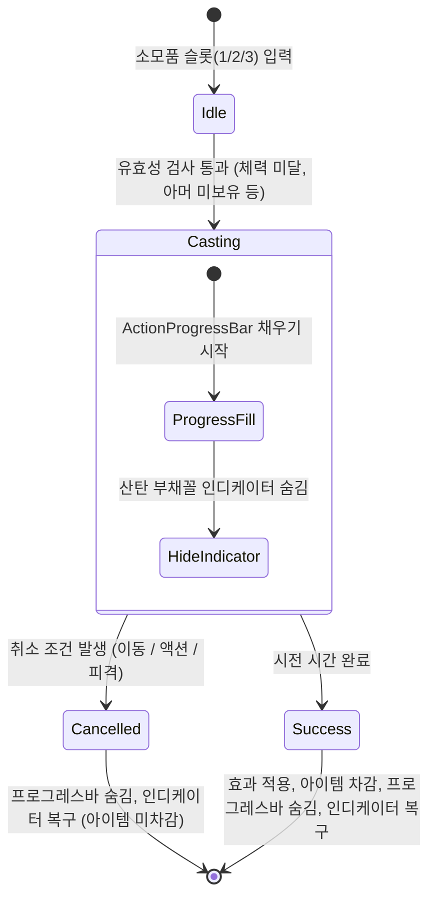

# 소모품 시스템 상세 기획 명세서: 아머 & 회복 아이템

> **최종 수정일:** 2026-10-05  
> **상태:** 기획 확정 (`game-spec.md` 7.6 소모품 연계)  
> **관련 담당자:** 김예찬(PM/기획), 김민석(플레이어 메카닉), 김호준(UI/소모품)

---

## 1. 개요 및 설계 의도

본 문서는 **"샷건 앤 런 (Shotgun and Run)"**의 긴장감 넘치는 전투 템포를 극대화하기 위해 개편된 **소모품 시전(Casting) 시스템**과 **아머(방탄복) & 체력 회복 아이템**의 세부 작동 규칙을 정의합니다.

### 핵심 설계 의도
1. **역할의 명확한 분리:**
   * **아머 (긴급 전투 대비):** 0.5초간 기동하며 착용. 다음 교전 시 피격 1회를 흡수하는 대신 이동속도가 10% 감소하는 명확한 **리스크-리턴(Risk & Return)** 제공.
   * **회복 아이템 (전술적 재정비):** 1~2초간 멈춰서 안전을 확보한 후 체력을 채우는 배틀로얄/익스트랙션 슈터 스타일의 **정적 힐링(Static Healing)**.
2. **시각적 일관성과 정보 전달:**
   * 무기 재장전에 사용하는 머리 위 행동 진행 막대(`ActionProgressBar`)를 소모품 사용 시에도 공유하여 추가 UI 복잡도를 줄이고 통일된 피드백 제공.
   * 아이템 사용 중 산탄 인디케이터(`SpreadArcIndicator`)를 숨겨 공격 불가 상태를 직관적으로 전달.
   * 아머는 체력 슬롯을 추가(+1)하는 것이 아니라 **가장 오른쪽에 있는 활성 하트에 방탄복을 입혀** 피격 시 해당 하트가 보호됨을 직관적으로 시각화.

---

## 2. 소모품 사용 공통 메카닉 (시전/채널링)

### 2.1 공통 라이프사이클


1. **아이템 차감 시점:**
   * 사용 시작 시 차감되지 않으며, **시전이 정상적으로 100% 완료된 순간에만 인벤토리/슬롯에서 1개 차감**.
   * 도중 취소(캔슬) 시 아이템은 소모되지 않고 보존됨.
2. **머리 위 진행 막대 (`ActionProgressBar`):**
   * 재장전 시 사용되는 머리 위 게이지와 동일한 컴포넌트 활용 (`StartFill(owner, duration)`).
   * 시전 시간 동안 왼쪽에서 오른쪽으로 게이지가 차오름.
   * **취소(캔슬) 시 연출:** 사용 중 이동(회복 시), 사격/재장전/대시, 피격 등으로 시전이 취소되면 **막대가 즉시 붉은색(Red)으로 변하며 좌우로 바들바들 흔들린(Shake) 후 사라지는 취소 피드백 효과**를 재생.
3. **산탄 부채꼴 인디케이터 (`SpreadArcIndicator`):**
   * 시전 시작 즉시 비활성화(`SetActive(false)` 또는 Hide).
   * 시전 완료 또는 취소 시 다시 표시.
4. **조준 방향 (Aiming / Cursor):**
   * 시전 중에도 **마우스 커서 방향 회전은 항상 허용** (상황 주시 및 시전 종료 즉시 사격 준비 가능).
5. **재장전(Reload)과의 우선순위:**
   * 샷건 재장전 도중 소모품 단축키(1, 2, 3번)를 누르면 **진행 중이던 재장전이 즉시 취소**되고 소모품 시전으로 즉시 전환됨 (`ActionProgressBar` 소유권 즉시 양도).

---

## 3. 아머 (Armor / 방탄 패치) 상세 명세

### 3.1 기본 스펙
* **분류:** 방어 버프 소모품
* **시전 시간:** **0.5초**
* **기동성 규칙:** **이동 중 시전 가능 (Move-cast 허용)**
* **효과:**
  * 즉시 **가장 오른쪽에 있는 하트 1칸에 방탄복(ARMOR) 적용** (방탄 하트로 변환).
  * 아머 보유 중 **이동속도 10% 감소** 디버프 적용.
* **지속 시간:** **무제한** (피격되어 아머가 벗겨질 때까지 영구 지속).
* **사용 제한 및 재착용 규칙:**
  * **동시 보유 제한:** **ARMOR는 최대 1개까지만 착용 가능**. 이미 아머가 적용되어 있는 동안에는 추가 사용 불가 (슬롯 비활성화 및 입력 차단).
  * **연속 착용 허용:** 피격으로 아머가 파괴되어 사라진 직후에는 쿨타임 제약 없이 **즉시 다시 0.5초 시전을 통해 아머를 재착용 가능** (슬롯당 소지 한도 최대 3개가 자연스러운 사용 한계선 역할을 함).

### 3.2 피해 흡수 및 여분 체력(오버힐) 메카닉
1. **여분 체력(오버실드) 판정 및 무적 시간:**
   * 아머는 시스템적으로 별도의 특수 방어 상태가 아닌 **"체력 1칸짜리 여분 체력(오버힐)"** 메카닉으로 처리됨.
   * 따라서 피격 시 통상 체력 피격과 완벽히 동일하게 `Damaged` 이벤트 호출, 피격 사운드/화면 흔들림 연출, 그리고 **피격 무적 시간(`PlayerInvulnerability.ActivateTimed`)이 정상적으로 발동**됨.
   * 다만 본체 체력(Heart)이 깎이지 않고, 덧입혀진 아머 1칸이 대신 100% 흡수 후 소멸됨.
2. **체력 회복 시 방탄복의 동적 이동 (A안):**
   * 아머는 특정 하트 슬롯 번호(예: 3번 슬롯)에 고정된 물리적 객체가 아니라 **"플레이어에게 귀속된 1회 방어권"**임.
   * 체력이 3/5인 상태에서 아머를 입은 뒤 구급상자로 체력을 1칸 회복(4/5)하면, **방탄복 오버레이는 새로 채워진 가장 오른쪽 활성 하트(4번째)로 자연스럽게 이동**함:  
     `[ ❤️ ][ ❤️ ][ 🛡️❤️ ][ 🤍 ][ 🤍 ]` (체력 3 + 아머)  
     💊 구급상자 1칸 회복 사용  
     `[ ❤️ ][ ❤️ ][ ❤️ ][ 🛡️❤️ ][ 🤍 ]` (체력 4 + 아머)
3. **디버프 즉시 해제:**
   * 아머가 피격으로 파괴되는 즉시 **이동속도 10% 감소 디버프가 제거**되어 정상 이동속도로 복구.
4. **아머 장착 취소(캔슬) 조건:**
   * 이동(WASD/좌스틱)은 허용되나, 0.5초 시전 도중 **사격(좌클릭), 재장전(R), 대시(Space) 행동 시 즉시 사용 취소**.
   * 0.5초 시전 도중 **적 피격을 당할 시 즉시 사용 취소** (아이템 미소모 보존).
   * 취소 시 `ActionProgressBar`가 **붉은색으로 변해 바들바들 흔들리며 소멸**하고, 샷건 인디케이터가 즉시 복구됨.

### 3.3 UI 표현 (`PlayerHealthUI`)
* 체력 하트 슬롯을 새로 추가(+1)하는 방식이 아니라, **현재 채워져 있는 하트 중 가장 오른쪽에 위치한 활성 하트에 방탄복 테두리/오버레이를 씌워 표현**.
* **피격 연출:**
  * 피격 시 체력 하트 수가 줄어들지 않고, 가장 우측 하트의 방탄복이 파편과 함께 벗겨지며 일반 하트로 돌아감:  
    `[ ❤️ ][ ❤️ ][ ❤️ ][ ❤️ ][ 🛡️❤️ ]`  
    💥 피격 발생! (피격 무적 시간 발동)  
    `[ ❤️ ][ ❤️ ][ ❤️ ][ ❤️ ][ ❤️ ]` *(체력 5칸 온전히 유지, 이속 디버프 즉시 해제)*

---

## 4. 체력 회복 아이템 (구급상자) 상세 명세

### 4.1 소모품별 스펙 비교

| 소모품명 | 시전 시간 | 회복량 | 이동 허용 | 캔슬 조건 | 아이템 차감 |
|---|:---:|:---:|:---:|---|:---:|
| **소형 구급상자 (SmallKit)** | **1.0초** | 체력 **1칸** | **불가 (정지)** | 이동 / 액션 / 피격 시 취소 | 완료 시 1개 |
| **대형 구급상자 (LargeKit)** | **2.0초** | 체력 **2칸** | **불가 (정지)** | 이동 / 액션 / 피격 시 취소 | 완료 시 1개 |

### 4.2 엄격한 정지 시전 (Static Channeling) 규칙
1. **이동 입력 시 즉시 취소:**
   * WASD 또는 패드 좌스틱으로 이동 벡터가 발생하는 즉시 회복이 취소됨.
2. **액션 입력 시 즉시 취소:**
   * 좌클릭(무기 발사), R(재장전), 스페이스바(대시/회피), 타 소모품 단축키 입력 시 즉시 취소.
3. **피격 시 즉시 취소:**
   * 시전 도중 적의 공격이나 투사체에 맞아 피해를 입으면 즉시 시전이 끊김.
4. **유일한 허용 행동:**
   * **마우스 커서 회전 (시야 확보/에임 조준)**만 허용.
5. **체력 최대치 제한 및 손해 사용 허용:**
   * 이미 체력이 꽉 찬 상태(MaxHealth)인 경우 사용 키를 눌러도 시전이 시작되지 않음.
   * **대형 구급상자(2칸 회복)의 손해 사용 허용:** 체력이 1칸만 깎여 있는 상태(예: 4/5)에서도 대형 구급상자를 사용할 수 있음. 이 경우 1칸만 채워지고 아이템 1개가 정상 소모됨 (손해를 보더라도 플레이어의 긴급 판단을 존중).

---

## 5. UI / UX 및 연출 가이드

| 연출 요소 | 아머 (Armor) | 회복 아이템 (Small/Large Kit) |
|---|---|---|
| **행동 진행 막대** | `ActionProgressBar` 0.5초 게이지 충전 | `ActionProgressBar` 1.0초 / 2.0초 게이지 충전 |
| **산탄 인디케이터** | 시전 중 숨김 (`SpreadArcIndicator` Off) | 시전 중 숨김 (`SpreadArcIndicator` Off) |
| **플레이어 이동** | 자유롭게 이동 가능 | **이동 불가** (이동 시 즉시 캔슬) |
| **취소 피드백** | 막대 붉은색 변경 + 좌우 바들바들 흔들림(Shake) 후 소멸, 샷건 인디케이터 복구 | 막대 붉은색 변경 + 좌우 바들바들 흔들림(Shake) 후 소멸, 취소 피드백 SFX |

---

## 6. 구현 개발 가이드 (참고용 구조 설계)

### 6.1 `ConsumableData` ScriptableObject 확장
```csharp
public class ConsumableData : ScriptableObject
{
    // 기존 필드들...
    [Header("Casting Settings")]
    [SerializeField] private float _castDuration = 0.5f;        // 소형 1.0f, 대형 2.0f, 아머 0.5f
    [SerializeField] private bool _allowMovementWhileCasting;    // 아머만 true
    [SerializeField] private bool _cancelOnDamage = true;        // 피격 시 취소
}
```

### 6.2 `ConsumableUseController` 흐름
1. `TryStartUseConsumable(ConsumableType type)`
   * 유효성 검사 (아머 이미 착용 여부, 체력 최대 여부, 현재 캐스팅 중 여부)
2. 시전 시작:
   * `ActionProgressBar.StartFill(this, duration)`
   * `SpreadArcIndicator.SetVisible(false)`
3. 프레임/이벤트 검사 (취소 판정):
   * 회복 아이템: `MovementInput != Vector2.zero` 시 `CancelUse()`
   * 공통: 사격(좌클릭), 재장전(R), 대시(Space) 입력 시 `CancelUse()`
   * 공통: `PlayerHealth.Damaged` 피격 발생 시 `CancelUse()`
4. 취소 시 (`CancelUse()`):
   * `ActionProgressBar.CancelWithShake(this)` 호출 (붉은색 변경 및 좌우 흔들림 후 Hide)
   * `SpreadArcIndicator.SetVisible(true)` 복구
   * 아이템 미소모 보존
5. 정상 완료 시:
   * `ApplyEffect(type)`
   * `Inventory.Remove(type, 1)`
   * `ActionProgressBar.Hide(this)`
   * `SpreadArcIndicator.SetVisible(true)`

### 6.3 `PlayerHealth` 및 `PlayerHealthUI` 연동
* `PlayerHealth`에 `public bool HasArmor { get; private set; }` 추가.
* `TakeDamage(DamageInfo damageInfo)` 시:
  ```csharp
  if (HasArmor)
  {
      HasArmor = false;
      _stats.RemoveMoveSpeedMultiplier("Armor"); // 이속 디버프 제거
      ArmorBroken?.Invoke();
      return true; // 데미지 무효화 (하트 차감 없음)
  }
  ```
* `PlayerHealthUI`는 `ArmorChanged(bool hasArmor)`를 구독하여, **가장 오른쪽에 있는 활성 하트의 스프라이트를 방탄 하트로 변경하거나 전용 방탄복 오버레이 이미지를 활성화/비활성화**.

### 6.4 `ActionProgressBar` 취소 연출(Cancel Shake) 확장 가이드
* 기존 `ActionProgressBar`에 취소 피드백용 메서드 추가 권장:
  ```csharp
  // 취소 시 막대 색상을 붉은색으로 바꾸고 좌우로 바들바들 흔든 뒤 Hide
  public void CancelWithShake(object owner)
  {
      if (_owner != owner) return;
      StopFillRoutine();
      StartCoroutine(CancelShakeRoutine());
  }

  private IEnumerator CancelShakeRoutine()
  {
      SetBarColor(Color.red);
      Vector3 originalPos = _visual.transform.localPosition;
      float elapsed = 0f;
      float shakeDuration = 0.2f;
      float shakeMagnitude = 2f / _pixelsPerUnit; // 2픽셀 흔들림
      
      while (elapsed < shakeDuration)
      {
          elapsed += Time.deltaTime;
          float xOffset = Mathf.Sin(elapsed * 50f) * shakeMagnitude;
          _visual.transform.localPosition = originalPos + new Vector3(xOffset, 0f, 0f);
          yield return null;
      }
      
      _visual.transform.localPosition = originalPos;
      Hide(_owner);
  }
  ```

---

## 7. 투척물 (수류탄류) 기획 및 구현 가이드 (추후 구현 예정)

> **대상 아이템:** 파편 수류탄 (`FragmentGrenade`), 섬광탄 (`FlashBang`)  
> **핵심 흐름:** 6시 퀵슬롯 장착 → 단축키 입력으로 조준 모드 진입(샷건 인디케이터 숨김 & 투척 궤적/범위 인디케이터 표시) → 마우스 좌클릭 투척(아이템 1개 소모) → 포물선 투사체 비행 → 정해진 시간 후 지연 폭발 (플레이어 자해 피해 포함)

### 7.1 6시 방향 장비/퀵슬롯 바 연동
1. **아이템 등록 및 장착:**
   * 인게임 화면 6시 방향(하단 중앙) HUD의 소모품 슬롯(1, 2, 3번)에 투척물 아이템을 등록/장착할 수 있어야 함.
   * 슬롯에 장착된 아이템의 현재 보유 수량(스택 카운트, 최대 3개)이 표기됨.

### 7.2 조준(Aiming) 및 인디케이터 전환
1. **단축키 입력 시 상태 전환:**
   * 파편 수류탄/섬광탄이 등록된 단축키(1, 2, 3번 중 해당 키)를 누르면 즉시 **투척 조준(Aiming) 모드**로 전환됨.
   * 기존 **샷건 부채꼴 인디케이터(`SpreadArcIndicator`)는 즉시 비활성화(숨김)** 처리.
   * 화면에 **투척 전용 인디케이터**가 출력됨.
2. **투척 인디케이터 구성:**
   * **곡선 궤적 라인 (Trajectory Line):** 플레이어 캐릭터와 마우스 커서 위치 사이에 포물선(곡선) 경로를 표시.
   * **폭발 범위 (AOE Indicator):** 커서가 위치한 착탄 지점에 원형 폭발 반경 테두리 표시.
     * 파편 수류탄: 반경 **2.5u**
     * 섬광탄: 반경 **4.0u**
3. **사정거리 제한 (Inspector 설정 가능):**
   * **사정거리 범위:** **1.0u ~ 8.0u**
   * 인스펙터(`[SerializeField]`)에서 최소/최대 사거리를 자유롭게 튜닝할 수 있도록 변수화 (`_minThrowRange = 1f`, `_maxThrowRange = 8f`).
   * 마우스 커서가 8.0u를 벗어날 경우, 최대 사거리(8.0u) 지점으로 착탄 지점이 자동 클램핑됨.
4. **조준 취소 (Cancel / Toggle 지원):**
   * **단축키 재입력 토글(Toggle):** 조준 상태에서 해당 투척물 단축키(1, 2, 3번)를 **한 번 더 누르면 조준이 취소**됨.
   * **기타 취소:** 마우스 우클릭을 누르거나, 다른 슬롯/무기 전환 키를 눌러도 조준이 취소되고 샷건 인디케이터로 복귀 (아이템 미소모). **(투척물 조준 모드 중에는 우클릭 대쉬가 차단되며 순수 조준 취소로만 작동함)**

### 7.3 투척 실행 및 투사체 이동
1. **발사 및 아이템 차감:**
   * 조준 상태에서 **마우스 좌클릭 시 즉시 투척이 실행**되며, 해당 슬롯의 아이템이 1개 소모됨.
   * 클릭 즉시 투척 인디케이터는 숨겨지고 샷건 인디케이터로 복구(또는 투척 후딜레이 후 복구).
2. **투사체 궤적 이동 (직사 및 벽 충돌 판정):**
   * 수류탄 투사체는 **직사 판정(Collision Throw)**을 따름.
   * 높이 개념으로 벽 너머로 날아갈 수 없으며, **궤적 도중 벽/장애물(Wall Collider2D)에 충돌하면 즉시 이동을 멈추고 충돌 지점 바닥에 낙하/도탄**됨.

### 7.4 지연 폭발 및 데미지/효과 판정 (플레이어 자해 피해 필수)
1. **지연 폭발 (Fuse Time):**
   * 파편 수류탄은 **투척 후 2.0초**(비행 시간 포함) 뒤에 폭발 VFX/SFX 재생. 비행 시간이 지나 착탄한 뒤 남은 시간 동안 바닥에서 대기한다.
2. **파편 수류탄 플레이어 자해 피해 (Friendly Fire):**
   * 폭발 시 적뿐만 아니라 **폭발 반경 내에 있는 플레이어도 반드시 동일하게 데미지를 입도록 구현**.
   * 구현 방식:
     ```csharp
     // 폭발 범위 내 Collider2D 감지
     Collider2D[] colliders = Physics2D.OverlapCircleAll(transform.position, explosionRadius);
     foreach (var col in colliders)
     {
         if (col.TryGetComponent<IDamageable>(out var damageable))
         {
             var damageInfo = new DamageInfo(explosionDamage, this.gameObject, DamageType.Explosion);
             damageable.TryTakeDamage(damageInfo);
         }
     }
     ```
   * 플레이어가 자폭/오폭으로 사망할 경우 사망 원인에 "수류탄 폭발"이 정상적으로 기록되도록 연계.
3. **섬광탄 플레이어 피격 효과 (화면 플래시 / 블라인드):**
   * 플레이어가 섬광탄 폭발 반경(4.0u) 안에 있을 경우, **전체 화면이 눈부신 백색으로 덮이는 화면 플래시(White Screen Flash) 연출** 적용.
   * 약 1~2초간 시야가 하얗게 가려진 뒤 서서히 정상 화면으로 페이드아웃 복구되며, 일시적인 상황 인지 마비 부여.
