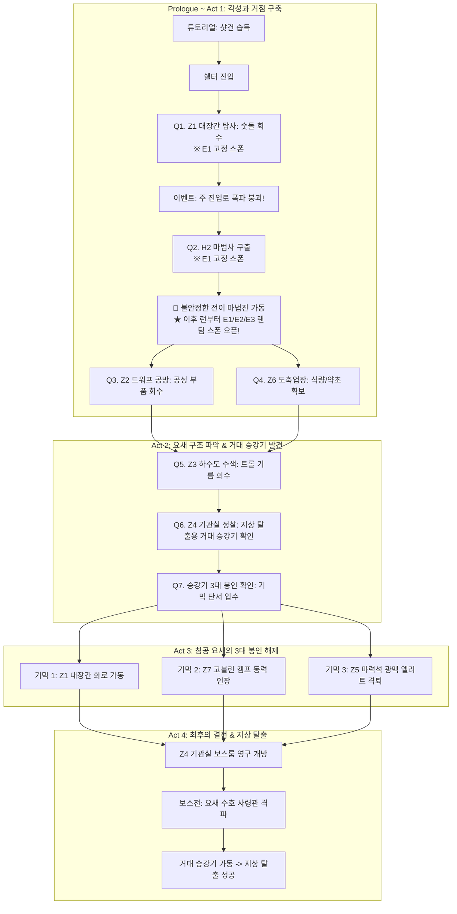

# 퀘스트 라인 & 스토리 컨셉 기획서

> **문서 상태:** 초안 (Draft)  
> **관련 문서:** [game-spec.md](game-spec.md) (명세 9.3 퀘스트 · 8장 무기 강화 · 4장 맵) / [level-design.md](level-design.md) (스테이지 1 구조)  
> **핵심 키워드:** 탑다운 슈터, 익스트랙션, 샷건(이질적 아티팩트), 지하 침공 요새, 고립된 생존자 쉘터

---

## 1. 개요 및 기획 의도

### 1.1 세계관 톤앤매너
- **다크 판타지 + 오버테크놀로지 아티팩트 (디젤펑크/화약 슈터):**  
  검과 마법, 몬스터가 지배하는 지하 유적에 어울리지 않는 현대/기계식 화기인 **'샷건'**이 등장하여 강렬한 대비와 이질적인 카타르시스를 부여합니다.
- **탑다운 익스트랙션 루프와의 결합:**  
  "왜 던전에 들어가서 파밍하고 반드시 살아서 탈출해야 하는가?"에 대한 명확한 서사적 동기(쉘터의 자원 고갈, 요새 탈출 승강기 복구, 무기 유지보수)를 제공합니다.

### 1.2 핵심 내러티브 아크
```
[낙오 & 각성] (튜토리얼)
  └ 절체절명의 위기에서 정체불명의 화기 '샷건' 습득 → 본능적 학살 및 생존
      ↓
[조우 & 동맹] (쉘터 첫 진입)
  └ 고립된 생존자 길드 거처 발견 → 지상 출구 봉쇄 확인 → 샷건을 통한 희망 제시
      ↓
[거점 정비 & 첫 파밍] (탐사 퀘스트 1: Z1 대장간)
  └ 샷건 수리를 위한 '숫돌' 확보 → 첫 익스트랙션 성공 → 강화/성장 체감
      ↓
[요새 공략 & 진실 규명] (메인 퀘스트 체인 & 기믹)
  └ 고블린/스켈레톤 군단의 침공 요새 조사 → 3대 봉인 해제 → 승강기(Z4) 가동 및 탈출
```

---

## 2. 시놉시스 및 세계관 설정

### 2.1 무대: 지하 침공 요새 (The Subterranean Citadel)
- 지상으로 진격하기 위해 고블린과 스켈레톤 군대가 비밀리에 축조했던 거대한 지하 요새 유적.
- 그러나 알 수 없는 대재앙 또는 지반 붕괴로 인해 지상으로 통하는 거대 승강기(Z4 동력실 연계)가 잠기고 요새 전체가 외부와 단절되었습니다.
- 폐허처럼 보이지만, 대장간(Z1)의 용광로와 기계식 설비들은 여전히 작동하며 침공 병력들이 곳곳을 점거하고 있습니다.

### 2.2 생존자 길드 쉘터 (The Haven)
- 지상에서 파견되었으나 퇴로가 막혀 낙오된 왕국 탐사대와 모험가들이 구축한 임시 거처.
- 지상 지원이 끊긴 지 수개월이 지나 식량, 의료품, 무기 보수 자재가 한계에 달했습니다.
- 거점 주변(커넥터 외곽)에서 소수의 자원만 주워오며 서서히 말라죽어가던 중, 주인공이 나타납니다.

### 2.3 이질적인 아티팩트: '샷건 (Trench Broom)'
- 고대 유적 가장 깊숙하고 이질적인 제단/방벽 틈새에 봉인되어 있던 정체불명의 쇳덩이.
- 마법도, 활도 아닌 화약 폭발로 납탄을 뿜어내는 흉포한 파괴 무기.
- 쥐는 순간 주인공의 전투 본능과 아드레날린을 폭발시키는 정체불명의 마력이 깃들어 있습니다.

---

## 3. 퀘스트 라인 상세 기획

### [튜토리얼] 퀘스트 0: 이질적인 쇳덩이 (The Anomaly)

#### 1) 시놉시스 & 연출
> **"탐사대는 전멸했다. 검은 부러졌고 횃불은 꺼져간다... 어둠 속에서 마주한 기괴한 제단 위에 차가운 쇳덩이 하나가 놓여 있다."**

- **도입부:** 무기를 잃고 부상당한 채 어두운 통로를 절뚝이며 시작. 전방에 고블린 정찰병들이 접근하는 위기 상황.
- **아티팩트 획득:** 무너진 석상 제단에서 **샷건**을 획득하는 인터랙션(E키).
- **각성:** 총기를 쥐는 순간 화면이 붉게 점멸하며 심장 박동 소리와 함께 **피가 끓어오르는 광기/각성 연출**.
- **전투 개시:** "어떻게 쓰는진 몰라도, 쏘지 않으면 내가 죽는다!"

#### 2) 튜토리얼 학습 동선 (조작 체계 매핑)
| 단계 | 게임플레이 상황 | 학습 목표 (명세 2장) |
|:---:|---|---|
| **1** | 제단 앞 적 무리 출현 | **마우스 조준 & 좌클릭 사격** (클릭당 1발, 묵직한 반동과 넉백 체감) |
| **2** | 잔탄 소진 (3발 발사 후 틱- 소리) | **R키 수동 재장전** (자동 재장전 없음 숙지) |
| **3** | 적 투척병(Thrower)의 폭탄 투척 | **우클릭 대쉬** (무적 회피 기동 습득) |
| **4** | 막다른 통로의 철문/상자 | **E키 2초 홀드** (상자 개방 및 상호작용 습득, 탄약 보충) |
| **5** | 거점 출구 통로 도달 | 대규모 일반 몹을 시원하게 소탕 후 쉘터 입구 통로로 진입 |

---

### [쉘터 진입] 프롤로그 완료: 절망 속의 불씨 (Sparks in the Dark)

#### 1) 시놉시스 & 연출
> **"연기와 화약 냄새를 풍기며 도착한 곳은 동굴 막다른 곳이 아니었다. 바리케이드 뒤로 지친 눈망울들이 나를 겨누고 있었다."**

- 샷건을 든 채 피투성이로 숨을 헐떡이며 쉘터 방벽을 통과.
- 생존자 경비병들이 놀라며 길드장(탐사대 대장)을 호출.
- 길드장 **'로나(Lona)'**와의 첫 대화 이벤트 발생.

#### 2) 대화 및 세계관 전달
- **길드장:**  
  *"살아서 돌아온 녀석이 있었을 줄이야... 꼴을 보니 자네 혼자인가 보군. 환영하네, 비록 무덤 같은 곳이지만."*  
  *"이곳은 지하 깊은 곳에 지어진 고대 군사 요새일세. 밖으로 나가는 거대 승강기가 굳게 닫혔고, 우린 고립됐지. 물자는 바닥났고 밖엔 괴물들이 득실대네."*
- **길드장의 시선이 주인공의 총으로 향함:**  
  *"...잠깐, 손에 들고 있는 그 흉흉한 쇳덩이는 뭔가? 활도 석궁도 아닌데 방금 바깥에서 터진 벼락 같은 소리가 저 물건에서 난 건가?"*
- **결론:**  
  *"자네가 쥔 그 이질적인 물건이 진짜라면... 어쩌면 우리가 여길 뚫고 나갈 유일한 돌파구가 될지도 모르겠군. 서로 돕지. 자네에겐 거점과 정비가 필요하고, 우리에겐 저 문을 부술 화력이 필요하니까."*

#### 3) 해금되는 쉘터 기능 (명세 10장)
- **창고:** 파밍한 재료 보관함 활성화
- **무기 개조대:** 샷건의 5대 파츠(총열, 약실, 탄띠, 개머리판, 탄약) 상태 열람 (현재 모두 0강)
- **게시판 / 의뢰 창구:** 메인 스토리 슬롯 1개 및 의뢰 슬롯 3개 활성화

---

### [탐사 퀘스트 1] 메인 스토리: 대장간의 숫돌 (Forging the Lead)

#### 1) 퀘스트 개요
- **의뢰인:** 길드 무기장인 '그룬 (Grun)' / 길드장 로나
- **스폰 규칙:** **E1 스폰 포인트 고정** (북서쪽, Z1 바로 앞). 첫 출격 온보딩을 위해 랜덤 스폰 제한.
- **목표:** **Z1 대장간**에 잠입하여 존 상자에서 **[정밀 숫돌]**을 회수하고, 활성화된 탈출 구역(Exit-A)을 통해 **살아서 탈출**하기.
- **분류:** 초반 탐사 (인증 아이템 회수형)

#### 2) 배경 스토리 & 당위성
- 무기장인이 주인공의 샷건을 감정해 봄:  
  *"놀라운 물건이야! 내부 기계 장치가 정교하게 맞물려 있소. 하지만 총열 안쪽 강선이 찌꺼기로 막혔고, 노리쇠 결합부가 마모되어 언제 폭발해도 이상하지 않소."*  
  *"이 무기를 오래 쏘고 강화하려면 제대로 된 연마 도구가 필수요. 북서쪽 구역(Z1)에 고블린 놈들이 군용 도검을 찍어내던 '대장간'이 있소. 거기 공구함에서 **[정밀 숫돌]**을 찾아오시오!"*
- 길드장의 조언:  
  *"던전에 오래 머물지 말게. 12분이 지나면 유독가스와 적들의 포위망이 좁혀온다네. 3분이 지나면 탈출로가 열리니, 숫돌을 챙기면 뒤도 돌아보지 말고 탈출 구역으로 뛰게."*

#### 3) 게임플레이 흐름 (루프 체감)
1. **출격 (E1 고정 스폰):**  
   - E1에서 시작 → 미니맵(Tab)을 열면 바로 인근에 **Z1(대장간)**이 있어 헤매지 않고 접근 가능.
2. **이동 & 커넥터 교전:**  
   - 순찰 몬스터 처치 (적 1기당 XP 5 획득). 탄약 아끼며 전진.
3. **Z1 대장간 진입 & 수비대 교전:**  
   - 용광로와 모루가 배치된 대장간 테마 구역 도착.
   - 존 수비대(일반 몹 청크) 소탕.
4. **인증 상자 루팅 (명세 9.3 반영):**  
   - Z1의 존 상자 3개 중 1개에서 **[정밀 숫돌 (퀘스트 아이템)]** 확정 드랍.
   - 가방 1칸 차지! (함께 나오는 철괴/납덩이 루팅).
5. **탈출 구역 대기 & 생존 (명세 4.4 반영):**  
   - 3분 경과 후 북서쪽 Exit-A 탈출 구역 활성화 알림.
   - 4u×4u 구역 안에서 **10초간 버티기**.
6. **쉘터 귀환 및 보상:**  
   - 탈출 성공! 가방 속 숫돌 및 재료 정산.

#### 4) 퀘스트 완료 보상 및 서사 이벤트
| 항목 | 내용 | 게임 내 효과 |
|---|---|---|
| **퀘스트 XP** | 300 XP (+ 탈출 런 보너스 50%) | 플레이어 레벨 Lv1 → Lv2 달성 (이동속도 +5% 해금) |
| **재료 지급** | 철괴 1개, 납덩이 1개, 치유 약초 3개 (창고 직행) | 총열/약실 파츠 Lv1 강화 준비 완료 |
| **시스템 해금** | **무기 파츠 강화 기능 정식 해금** (탈출 후 그룬에게 보고할 때) | 샷건 기본 데미지/집탄률 업그레이드 체감 |
| **🚨 서사 이벤트** | **주 진입로 폭파 붕괴 발생!** | 아래 퀘스트 2로 연결 |

> **[긴급 서사 이벤트 연출]** (2026-10-10 확정, 대본: [quests/CS_Q1_WHETSTONE.md](quests/CS_Q1_WHETSTONE.md))  
> 숫돌을 들고 탈출해 쉘터로 돌아오면, 로나와 경비병 3명이 무너지는 던전 입구를 지켜보는 장면이 먼저 나온다. 주인공은 연출이 끝난 뒤 귀환 지점에 나타난다.  
> 길드장 로나: *"빌어먹을... 고블린 놈들이 주 진입로를 폭파시켰어!"* *"통로가 완전히 잔해로 막혔네. 이대로면 던전에 발도 못 들이겠어."*  
> 이후 주인공이 그룬에게 숫돌을 보고하면 강화가 해금되고, 그룬이 "로나가 할 말이 있다더군"이라며 로나에게 보낸다. 엘레나 이야기는 로나의 Q2 브리핑에서 처음 나온다.

---

### [탐사 퀘스트 2] 메인 스토리: 마법사 구출 (Rescue the Mage)

> 연출 대본: [quests/CS_Q2_MAGE_RESCUE.md](quests/CS_Q2_MAGE_RESCUE.md)

#### 1) 퀘스트 개요
- **의뢰인:** 길드장 로나
- **스폰 규칙:** **E1 고정 스폰** (북서쪽 진입로). 초반 동선 안정성을 위해 E1 유지.
- **진행 위치:** **H2 홀** (드워프 공방 Z2 ↔ E2 사이의 30×32u 거대 홀, 중앙 정사각 기둥 사이)
- **목표:** H2 홀 중앙에 포박된 마법사 '엘레나'와 상호작용 → 매복 적 웨이브 소탕 → 마법사 결박 해제 → **플레이어 독자 탈출**.
- **분류:** 인물 구출 & 이벤트 웨이브형

#### 2) 배경 스토리 & 당위성
- 길드장:  
  *"자네가 오기 전에, 드워프 공방(Z2) 인근을 살피러 갔던 마법사 엘레나가 놈들의 함정에 빠져 붙잡혔다는 첩보네. 그녀가 죽으면 우린 던전 안으로 영영 들어갈 수 없어."*  
  *"자네를 북서쪽(E1)으로 다시 보내겠네. 거기서 남쪽으로 내려가 드워프 공방 길목의 홀(H2)을 수색해 주게. 놈들의 손에서 엘레나를 구해내게!"*

#### 3) 게임플레이 흐름 (인카운터 설계)
1. **출격 (E1 고정 스폰):**  
   - 북서쪽 E1 스폰에서 출발하여 남쪽으로 이동, 드워프 공방(Z2) 인근의 H2 홀로 진입.
2. **목표 발견 (H2 홀):**  
   - H2 홀 중앙의 기둥 사이에 밧줄로 단단히 결박되어 있는 마법사 엘레나 발견.
3. **1차 상호작용 (E키): 함정 발동 & 전투 개시:**  
   - 마법사에게 다가가 E키로 상호작용하는 순간 적들의 경보가 울리며 **매복 웨이브 발생!**  
   - 엘레나: *"함정이에요! 뒤를 조심해요!"*  
   - H2 홀의 두 정사각 기둥을 엄폐물로 삼아 돌진하는 적들과 투척병들을 샷건으로 격퇴.
4. **2차 상호작용 (E키): 포박 해제:**  
   - 웨이브 소탕 완료 후 다시 엘레나에게 다가가 E키를 홀드해 밧줄을 풀어줌.
5. **마법사의 텔레포트 귀환 (플레이어 분리):**  
   - 엘레나가 일어나 지팡이를 들며 전이 주문을 시전.  
   - 엘레나: *"고마워요! 마력이 조금 회복됐으니 전 먼저 쉘터로 공간 전이할게요. 당신도 어서 탈출하세요!"* (빛과 함께 먼저 쉘터로 사라짐).
6. **플레이어 독자 탈출 (Extraction):**  
   - 플레이어는 남은 체력과 탄약으로 탈출 구역(Exit-C 또는 Exit-B)으로 이동하여 10초 대기 후 탈출!

#### 4) 퀘스트 완료 보상 및 핵심 시스템 해금
| 항목 | 내용 | 게임 내 효과 |
|---|---|---|
| **퀘스트 XP** | 500 XP (+ 탈출 런 보너스 50%) | 플레이어 레벨 Lv2 → Lv3 달성 (**가방 +1칸 해금: 5칸 → 6칸**) |
| **NPC 합류** | 마법사 '엘레나' 쉘터 상주 | 쉘터 중앙에 **[불안정한 전이 마법진]** 설치 |
| **🌌 핵심 해금** | **랜덤 스폰 (무작위 출격) 정식 오픈** | **Run 4부터 출격 시 E1 · E2 · E3 중 무작위 1곳으로 전이!** |

> **[마법사의 설명 & 무작위 스폰의 서사적 개연성]**  
> 쉘터로 무사히 돌아온 엘레나가 중앙 마법진을 가동하며 설명:  
> *"던전 주 통로가 막혔지만, 이 마법진을 통해 던전 내부로 당신을 보내드릴 수 있어요. 하지만 요새 심층부의 마력 맥석이 심하게 뒤틀려 있어서... 정확한 좌표 하나로 고정할 수가 없어요."*  
> *"제가 전이해 드릴 수 있는 위치는 던전 외곽의 마력 균열 3곳(E1, E2, E3) 중 하나예요. 들어갈 때마다 어디로 떨어질지 알 수 없으니, 주변 지형을 잘 살피고 작전을 짜셔야 해요!"*

---

## 4. 메인 퀘스트 라인 전체 로드맵 (전체 흐름 구상)



### 단계별 서사 전개 요약

| 챕터 | 주요 활동 존 | 스폰 방식 | 서사적 목표 & 시스템 해금 |
|---|---|:---:|---|
| **Prologue ~ Act 1** | Z1 (대장간)<br>H2 홀 (마법사 구출)<br>Z2, Z6 | **E1 고정 (Q1, Q2)**<br>↓<br>**E1~E3 랜덤 오픈 (Run 4~)** | • 무기 1강 해금<br>• 마법사 구출 및 **랜덤 스폰 해금**<br>• 가방 6칸 확장 (Lv3 달성) |
| **Act 2. 탈출로 탐색** | Z3 (하수도)<br>Z4 (기관실)<br>Z10 (의무실) | 랜덤 스폰 (E1~E3) | 요새 중앙의 거대 승강기(Z4)를 발견하나, 동력이 차단되고 3중 봉인 기믹으로 잠겨 있음을 확인. |
| **Act 3. 3대 봉인 해제** | Z1 (대장간 기믹)<br>Z7 (고블린 캠프 기믹)<br>Z5 (마력석 광맥 - 고위험) | 랜덤 스폰 (E1~E3) | 마법사 엘레나의 마력석 공명 연구를 바탕으로 각 기믹룸을 영구 가동. 스켈레톤 군단 부활 저지. |
| **Act 4. 승강기 결전** | Z4 동쪽 보스룸 | 자유 출격 | 승강기를 지키는 침공군 총사령관 격파. 승강기를 타고 생존자들과 함께 지상으로 귀환. |

---

## 5. 주요 등장인물 및 대사 컨셉

### 5.1 주인공 (The Drifter / Straggler)
- **성향:** 말수가 적고 냉철하나, 샷건을 쥐었을 때만큼은 흉포한 파괴 본능이 번뜩이는 안티히어로적 면모.
- **특징:** 판타지 세계의 인물이지만 샷건의 펌프 액션과 셸 장전에 본능적으로 매료됨.

### 5.2 길드장 '로나' (Lona)
- **역할:** 쉘터의 지도자이자 전 탐사대 대장(명사수). 이성적이고 현실적인 지략가.
- **성격:** 고립의 무게감으로 지쳐 있었으나, 주인공의 활약으로 점차 탈출의 희망을 품음.
- **주요 대사:**  
  *"우린 여기서 뼈를 묻을 작정이 아니었네. 자네의 그 무쇠 방망이가 길을 열어준다면, 내 목숨을 걸고 자네의 등을 받쳐주지."*

### 5.3 대장장이 '그룬' (Grun)
- **역할:** 샷건 파츠 강화 및 무기 개조 담당 NPC.
- **성격:** 화기와 기계공학적 호기심에 눈이 먼 드워프/노움 계열 장인.
- **주요 대사:**  
  *"화약 가루 냄새... 산탄이 퍼지며 뼈마디를 부수는 이 소리! 예술이야! 재료만 가져오쇼. 약실이든 총열이든 드워프 왕의 갑옷보다 단단하게 벼려줄 테니!"*

### 5.4 궁정 마법사 '엘레나' (Elena)
- **역할:** 차원 전이 마법진 관리(랜덤 스폰), 텔레포트 장치(TP-2 ↔ TP-6) 연구, 마력석 기믹 분석 NPC.
- **성격:** 지적이고 차분하지만, 위기의 순간에는 강단이 있는 마도학자.
- **주요 대사:**  
  *"그때 H2 홀에서 구해주지 않으셨다면 전 이미 차가운 시체가 되었을 거예요. 던전의 마력이 요동쳐서 원하는 곳으로 바로 보내드릴 순 없지만... 적어도 당신이 싸울 기회는 만들어 드릴게요."*

---

## 6. 개발 반영 가이드 (데이터 테이블 매핑 예시)

```json
[
  {
    "quest_id": "SQ_MAIN_001",
    "quest_type": "EarlyExploration",
    "quest_slot": "Story",
    "title": "대장간의 숫돌",
    "target_zone": "Z1",
    "fixed_spawn_point": "E1",
    "required_item": "ITEM_QUEST_WHETSTONE_01",
    "completion_condition": "ExtractionSuccessWithItem",
    "rewards": {
      "xp": 300,
      "materials": [
        { "id": "MAT_IRON_INGOT", "count": 1 },
        { "id": "MAT_LEAD_LUMP", "count": 1 },
        { "id": "MAT_HEB_HERB", "count": 3 }
      ],
      "unlocked_features": ["WeaponUpgrade_Level1", "Trigger_Entrance_Collapse_Event"]
    }
  },
  {
    "quest_id": "SQ_MAIN_002",
    "quest_type": "RescueEvent",
    "quest_slot": "Story",
    "title": "마법사 구출",
    "target_location": "H2_Hall",
    "fixed_spawn_point": "E1",
    "trigger_interaction": "NPC_Elena_Bound",
    "event_waves": "Wave_H2_Ambush",
    "post_wave_interaction": "NPC_Elena_Free",
    "completion_condition": "PlayerExtractionSuccess",
    "rewards": {
      "xp": 500,
      "materials": [
        { "id": "MAT_HEB_HERB", "count": 3 }
      ],
      "unlocked_features": ["NPC_Elena_In_Shelter", "Random_Spawn_E1_E2_E3_Enabled"]
    }
  }
]
```
